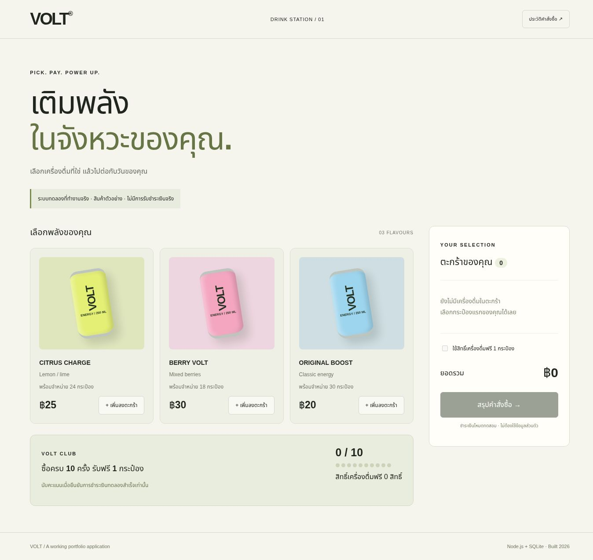
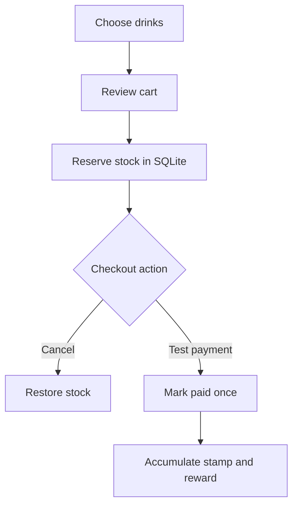

# VOLT — Drink Station v2

A newly developed working portfolio web application (30 October 2026), with a Thai shopping interface and persistent SQLite transactions. This is a test storefront, not a real vending machine or payment service. Built with AI assistance in ChatGPT Work under Panupong Intasan’s direction.



## Run

Requires Node.js 24 or newer. No third-party npm packages or separate database server required.

```bash
npm start
```

Open http://localhost:3000. Database is created automatically at `data/vending.sqlite`. Set `PORT` and `DB_FILE` to override defaults. Keep the database outside version control. An anonymous HttpOnly cookie identifies each browser; clearing it loses access to that browser's order history and rewards.

```bash
npm test
```

## Implemented and exercised

- Product catalog and stock loaded from SQLite; quantity selection and cart totals.
- Server-calculated order amount, stock reservation inside a transaction, cancellation restoring stock.
- Explicit test-payment confirmation, duplicate payment rejection, session-owned orders.
- One stamp per paid purchase, ten stamps earn one free unit; reward discounts the cheapest selected unit and is consumed only on payment.
- Order history and loyalty persist after reload. Closing the checkout dialog keeps the pending order; reopen it from history or cancel it.
- One pending order per session; replacing it restores the old reservation atomically. Failed replacement preserves the old order.

## Business flow



## Actual browser evidence

| Evidence | What was observed |
|---|---|
| [Storefront](evidence/01-storefront.jpg) | Catalog, stock, cart and loyalty interface |
| [Order review](evidence/02-order-review.jpg) | Citrus + Berry, server total THB 55 |
| [Paid order](evidence/03-paid.jpg) | Explicit test-payment success |
| [Test output](evidence/api-tests.txt) | 4 API suites passed, including rejection cases and ten-purchase reward cycle |

Browser checks also confirmed stock 24→23 / 18→17 and loyalty 0→1 after reload. Screenshots are from the real running application. CSS can illustrations are design assets, not photographs of an actual product.

## Limits

No PromptPay QR, bank callback, physical dispensing, admin system or public production hosting. Sessions and unpaid reservations currently have no automatic expiry, and there is no rate limiting or account recovery. This version is suitable for local portfolio testing, not public unattended commerce. Inventory, products and purchase history are test records. Desktop browser workflow was exercised; mobile devices and full accessibility audits are not yet verified.

See [source provenance](SOURCE_STATUS.md) and [acceptance checks](ACCEPTANCE.md).
