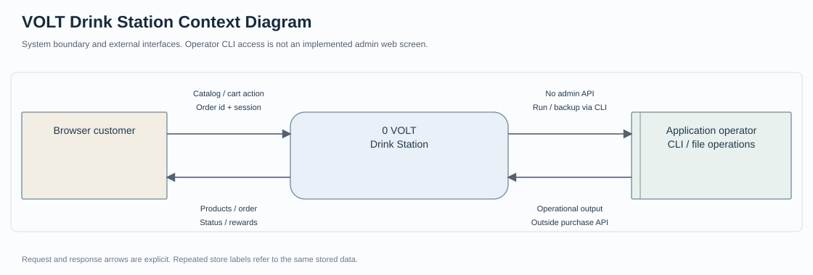
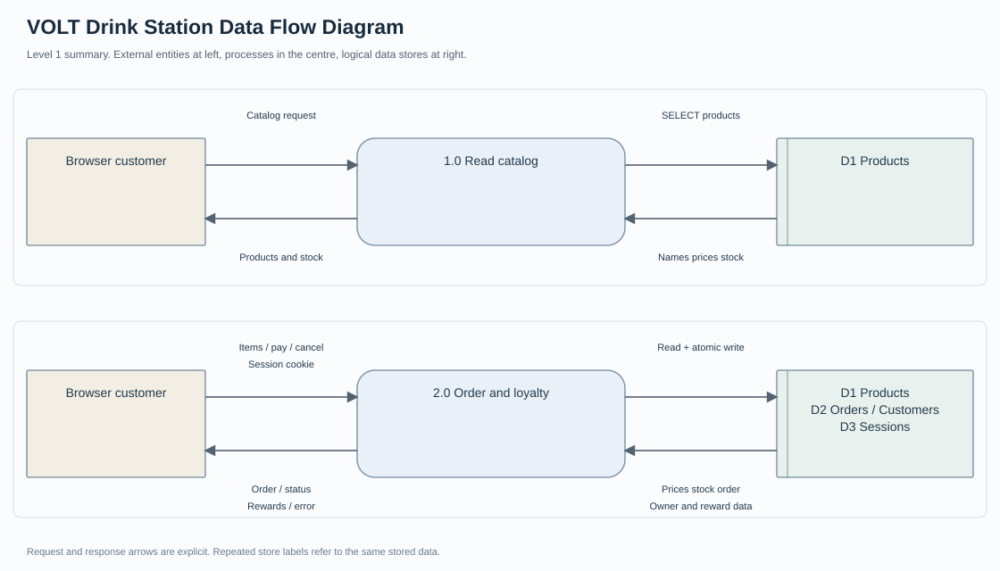
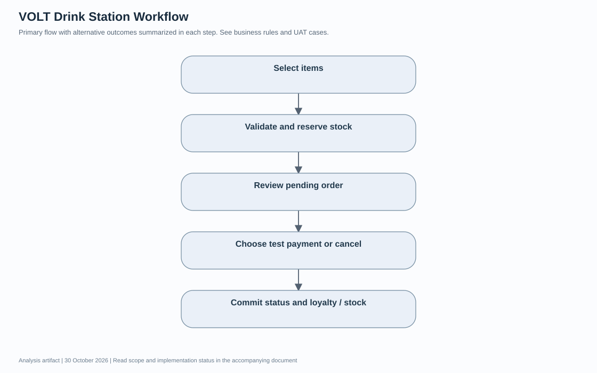
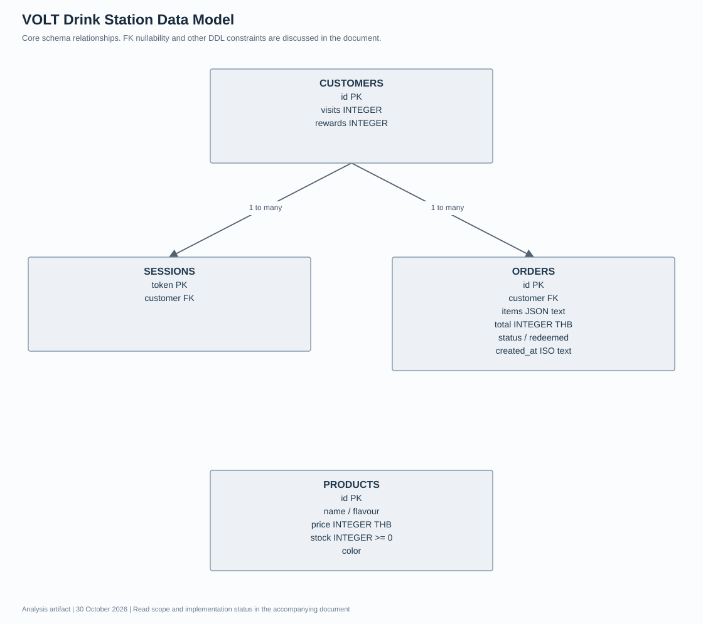

# VOLT Drink Station เอกสารวิเคราะห์ความต้องการและออกแบบระบบ

รุ่นเอกสาร 1.0 · วันที่ 30 October 2026 · ผู้จัดทำ Panupong Intasan โดยใช้ AI assistance ใน ChatGPT Work

ให้ผู้ใช้เลือกเครื่องดื่ม ตรวจยอด สร้างคำสั่งซื้อ และติดตามคะแนนได้ในเบราว์เซอร์ โดยตรวจสต็อกและคำนวณยอดจากเซิร์ฟเวอร์ ระบบนี้เป็นแอปทดลองที่บันทึกรายการจริงใน SQLite ไม่เชื่อมเครื่องจำหน่ายหรือธนาคาร

**สถานะเอกสาร:** จัดทำใหม่จากการอ่านโค้ด ณ commit `5c5e3493facc401d21b52cf6cb7a78693f58810d` เพื่ออธิบายระบบและใช้ตรวจรับ ไม่ใช่บันทึกการสัมภาษณ์หรือหลักฐานว่าผู้มีส่วนได้ส่วนเสียอนุมัติ Requirement แล้ว รายการที่ยังต้องตัดสินใจอยู่ในหัวข้อคำถามยืนยัน

[อ่านฉบับเว็บบน Portfolio](https://intasan.github.io/portfolio/analysis/vending/index.html) · [ไฟล์ HTML](analysis.html) · [Diagram source](diagrams/)

## 1 เป้าหมาย ผู้ใช้งาน และขอบเขต

| ผู้เกี่ยวข้อง | หน้าที่ |
| --- | --- |
| ผู้ซื้อในเบราว์เซอร์ | เลือกสินค้า ตรวจยอด ยืนยันชำระทดลอง ยกเลิก และดูประวัติ |
| ผู้ดูแลโครงการ | ติดตั้งระบบ ดูแลไฟล์ฐานข้อมูลและเรียกใช้ชุดทดสอบ ไม่มีหน้า Admin ในรุ่นนี้ |

**อยู่ในขอบเขต:** Catalog, Cart, Order, Test payment, Stock reservation, Loyalty และประวัติตาม anonymous session

**อยู่นอกขอบเขต:** PromptPay จริง การตัดเงิน การจ่ายสินค้าจากฮาร์ดแวร์ บัญชีสมาชิกข้ามอุปกรณ์ และระบบจัดการสินค้า

## 2 วิธีเก็บและยืนยันความต้องการ

เอกสารรอบนี้ใช้ source review, schema review และผลทดสอบที่มีอยู่เป็น input ข้อกำหนดแบบ As implemented ใช้อธิบายพฤติกรรมที่พบในโค้ด ส่วน To be เป็นข้อเสนอหรือคำถามที่ยังไม่ได้อนุมัติ ไม่มีการสร้างชื่อผู้ให้สัมภาษณ์ วันประชุม หรือผลลงนามย้อนหลัง

กระบวนการยืนยันที่เสนอคือให้ผู้ใช้งานหลักทบทวน scope และ Business Rules จากนั้นเดินผ่าน scenario ปกติและข้อผิดพลาด บันทึกคำตอบพร้อมผู้ตัดสินใจ แล้วปรับ version ของ Requirement และ UAT ก่อนรับรองการใช้งานจริง

## 3 Functional Requirements และเกณฑ์ยอมรับ

ทุกแถวต่อไปนี้เป็น **As implemented จากโค้ด** คอลัมน์หลักฐานแยกสิ่งที่มีการทดสอบเดิมกับสิ่งที่เพียงพบใน source การจัดทำเอกสารไม่ได้ทำให้ผลทดสอบที่ยังรออยู่กลายเป็นผ่าน

| รหัส | ความต้องการ | เกณฑ์ยอมรับ | Source | หลักฐานหรือสถานะ |
| --- | --- | --- | --- | --- |
| V-FR01 | อ่านรายการสินค้าและสต็อกจาก SQLite | GET /api/products คืนชื่อ ราคา และ stock ตามฐานข้อมูล | server.js | API / browser เดิม |
| V-FR02 | เพิ่ม ลด และนำสินค้าออกจากตะกร้า | จำนวนใน UI และยอดรวมเปลี่ยนตามรายการที่เลือก | public/app.js | browser เดิม เฉพาะเพิ่มสินค้า |
| V-FR03 | สร้างคำสั่งซื้อด้วยราคาฝั่งเซิร์ฟเวอร์ | ไม่ใช้ราคาที่ client ส่งมา และสร้างสถานะ pending เมื่อข้อมูลผ่าน | server.js | tests/orders.test.js |
| V-FR04 | ป้องกันจำนวนไม่ถูกต้องและสินค้าซ้ำ | จำนวนเป็นจำนวนเต็ม 1–10 ต่อสินค้า ไม่เกินสต็อก รายการ 1–3 ชนิดและ id ไม่ซ้ำ | server.js | tests/orders.test.js |
| V-FR05 | กันสต็อกพร้อมคำสั่งซื้อแบบ transaction | สร้าง order และลด stock สำเร็จพร้อมกัน หรือ rollback ทั้งชุด | server.js | tests/orders.test.js |
| V-FR06 | แทนที่ pending order ของ session เดิม | คืนสต็อกเดิมแล้วสร้างใหม่ใน transaction เดียว ความล้มเหลวต้องคง pending เดิม | server.js | tests/orders.test.js |
| V-FR07 | ชำระทดลองได้ครั้งเดียว | pending → paid เท่านั้น การชำระซ้ำตอบ 409 และไม่เพิ่มคะแนนซ้ำ | server.js | tests/orders.test.js / browser เดิม |
| V-FR08 | ยกเลิก pending order และคืนสต็อก | เจ้าของรายการยกเลิกได้ และสถานะเปลี่ยนเป็น cancelled | server.js | tests/orders.test.js |
| V-FR09 | สะสมและแลกเครื่องดื่มฟรี | ทุก 10 paid orders ได้ 1 reward ใช้ลดราคาหน่วยที่ถูกที่สุดในตะกร้า | server.js | tests/orders.test.js |
| V-FR10 | ดูเฉพาะประวัติของ session ปัจจุบัน | GET /api/me คืนประวัติและคะแนนของ customer ที่ผูก cookie การเปลี่ยนรายการผู้อื่นถูกปฏิเสธ | server.js | tests/orders.test.js |

## 4 Business Rules

1. หนึ่งคำสั่งซื้อ paid ได้ 1 stamp ไม่ใช่ 1 stamp ต่อกระป๋อง
2. visits เก็บเศษรอบ 0–9; rewards เก็บจำนวนสิทธิ์คงเหลือ
3. ยอดรวม = Σ(price × quantity) − ราคาหน่วยต่ำสุด เมื่อเลือกใช้สิทธิ์และมีสิทธิ์เพียงพอ
4. สิทธิ์ถูกใช้เมื่อชำระสำเร็จ ไม่ถูกหักเพียงเพราะเปิดหน้าตรวจยอด
5. pending order ไม่มีเวลาหมดอายุอัตโนมัติในรุ่นปัจจุบัน การกันสต็อกจึงค้างจนยกเลิกหรือแทนที่

## 5 Non Functional Requirements

| รหัส | ประเด็น | เกณฑ์และสถานะ |
| --- | --- | --- |
| vending-NFR01 | Data integrity | ใช้การตรวจสอบ input และการบันทึกที่สอดคล้องกับ business rules; ดูข้อจำกัดรายโครงการด้านล่าง |
| vending-NFR02 | Access control | ตรวจสิทธิ์ที่ server ตาม actor และ endpoint; ไม่อ้างสิทธิ์ที่ระบบยังไม่มี |
| vending-NFR03 | Observability | ต้องอธิบาย error / unavailable และ provenance ที่มีอยู่; audit trail แบบสมบูรณ์ยังไม่ถือว่ามี |
| vending-NFR04 | Usability | เสนอให้ทดสอบ desktop และ mobile ตั้งแต่ 360 px พร้อม keyboard; ยังไม่มีผลตรวจครบทุกขนาด |
| vending-NFR05 | Performance | ยังไม่มี SLA ที่ผู้เกี่ยวข้องอนุมัติ ต้องกำหนดจำนวนผู้ใช้และเกณฑ์ response time ก่อน load test |
| vending-NFR06 | Recovery | เสนอให้ทดสอบสำรองและกู้คืนข้อมูลพร้อมไฟล์ที่สัมพันธ์กัน; RPO/RTO ยังต้องตกลง ไม่กำหนดตัวเลขแทนผู้ใช้ |

## 6 Context Diagram

อ่านร่วมกับ [Mermaid context source](diagrams/context.mmd) ซึ่งแสดงข้อมูลขาเข้าและขาออกแยกทิศทาง Context Diagram กำหนดขอบเขตระบบทั้งก้อน ไม่แสดง data store ภายใน

## 7 Data Flow Diagram และทะเบียนข้อมูล

ภาพ SVG เป็น process overview แบบย่อ ส่วน [DFD Mermaid source](diagrams/data-flow.mmd) และทะเบียนด้านล่างแสดงทิศทาง request/response และ data store อย่างละเอียด ห้ามตีความลูกศรเป็นลำดับเวลาดำเนินงานอย่างเดียว

| Flow | ต้นทาง | ปลายทาง | ข้อมูลที่ส่งไป | ข้อมูลตอบกลับ |
| --- | --- | --- | --- | --- |
| D01 | ผู้ซื้อ | 1.0 Catalog | คำขอสินค้า | รายการสินค้าและ stock |
| D02 | ผู้ซื้อ | 2.0 Order | id และ quantity / redeem | pending order หรือ validation error |
| D03 | 2.0 Order | D1 Products | อ่านราคาจริงและ stock; ลด/คืน stock | ราคากับ stock ปัจจุบัน |
| D04 | 2.0 Order | D2 Orders Customers Sessions | สร้าง/อ่าน order; ปรับสถานะ stamp/reward | order และสิทธิ์ของ session |
| D05 | ผู้ซื้อ | 2.0 Order | pay/cancel พร้อม cookie | paid/cancelled หรือ 404/409 |

## 8 Workflow

1. เลือกสินค้าและจำนวน
2. สร้าง pending และกันสต็อก
3. ตรวจคำสั่งซื้อ
4. ชำระทดลอง หรือยกเลิก
5. บันทึกสถานะและคะแนน หรือคืนสต็อก

ข้อผิดพลาดต้องส่งผลตาม Requirement ที่เกี่ยวข้องและไม่ข้ามการตรวจสิทธิ์หรือความถูกต้องของข้อมูล [แก้ไข Mermaid workflow](diagrams/workflow.mmd)

## 9 Data Model และ Data Dictionary

แบบจำลองแสดง core entities ตาม schema ที่ตรวจอ่าน ความสัมพันธ์ที่แอปคาดหวังอาจเข้มกว่าข้อจำกัด nullable ของฐานข้อมูล จึงต้องอ่าน DDL และ validation ประกอบ

| Entity หรือ data store | ข้อมูลหลัก |
| --- | --- |
| CUSTOMERS | id PK; visits INTEGER; rewards INTEGER |
| SESSIONS | token PK; customer FK |
| ORDERS | id PK; customer FK; items JSON text; total INTEGER THB; status / redeemed; created_at ISO text |
| PRODUCTS | id PK; name / flavour; price INTEGER THB; stock INTEGER >= 0; color |

`orders.items` เก็บ JSON text ของรายการ id/name/price/quantity ซึ่งเป็น snapshot ณ เวลาสั่ง ไม่มีตาราง order_items และไม่มี FK ระหว่าง JSON กับ products แม้แอปจะตรวจ id ก่อนบันทึก

| Parent | Child | Relationship |
| --- | --- | --- |
| CUSTOMERS | SESSIONS | 1 to many |
| CUSTOMERS | ORDERS | 1 to many |

[Mermaid data model source](diagrams/data-model.mmd)

## 10 UAT และ Requirement Traceability

ตารางนี้เป็น test design และ mapping กับหลักฐานที่มี การผ่าน unit/API test ไม่เท่ากับผู้ใช้ปลายทางลงนาม UAT

| Test ID | Requirement | ขั้นตอนหรือ input | ผลคาดหวัง | สถานะหลักฐาน |
| --- | --- | --- | --- | --- |
| V-UAT01 | V-FR03 V-FR05 | Citrus 2 หน่วย ราคา 25 | ยอด 50 และ stock ลด 2 | ผ่าน API เดิม |
| V-UAT02 | V-FR04 | ส่งจำนวน 0 เศษส่วน สินค้าซ้ำ หรือเกิน 10 | ปฏิเสธโดยไม่เปลี่ยนสต็อก | ผ่าน API เดิม |
| V-UAT03 | V-FR07 | กดยืนยัน pay ซ้ำ | 409 และ stamp ไม่เพิ่มซ้ำ | ผ่าน API เดิม |
| V-UAT04 | V-FR08 | ยกเลิก pending | stock คืนตามจำนวนที่กัน | ผ่าน API เดิม |
| V-UAT05 | V-FR09 | ซื้อและจ่าย 10 คำสั่ง แล้วแลก 1 สิทธิ์ | ได้ 1 reward และใช้สิทธิ์ได้ครั้งเดียว | ผ่าน API เดิม |
| V-UAT06 | V-FR10 | อีก session พยายามจ่ายคำสั่งซื้อเดิม | 404 ไม่มีการเปลี่ยนรายการ | ผ่าน API เดิม |

**ผู้ตรวจรับ:** ยังไม่กำหนด · **วันที่ตรวจรับกับผู้ใช้:** ยังไม่ดำเนินการในรอบเอกสารนี้ · **ผลลงนาม:** ยังไม่มี

## 11 ข้อจำกัดและความเสี่ยง

- ไม่มี expiry, rate limiting หรือการกู้คืนบัญชี จึงยังไม่พร้อมเปิด commerce สาธารณะ
- ต้องทดสอบบนมือถือและทดสอบปิดโปรเซสแล้วเปิดใหม่ก่อนรับรองการใช้งานระยะยาว

## 12 คำถามที่ต้องยืนยันก่อนขยายระบบ

1. จะให้ pending order หมดอายุภายในกี่นาที และคืนสต็อกโดยกระบวนการใด
2. สิทธิ์ฟรีควรนับจากจำนวนครั้งหรือจำนวนหน่วย และยอดศูนย์ยังได้ stamp หรือไม่
3. ต้องมีบัญชีสมาชิกเพื่อกู้คืนคะแนนเมื่อ cookie หายหรือไม่
4. จะเพิ่ม Admin และบันทึกประวัติปรับสต็อกอย่างไร
5. หากเชื่อมธนาคารภายหลัง ต้องตรวจ webhook และ idempotency อย่างไร

## 13 Source Baseline และประวัติเอกสาร

- [server.js](https://github.com/intasan/energy-drink-vending-machine/blob/5c5e3493facc401d21b52cf6cb7a78693f58810d/server.js)
- [public/app.js](https://github.com/intasan/energy-drink-vending-machine/blob/5c5e3493facc401d21b52cf6cb7a78693f58810d/public/app.js)
- [tests/orders.test.js](https://github.com/intasan/energy-drink-vending-machine/blob/5c5e3493facc401d21b52cf6cb7a78693f58810d/tests/orders.test.js)
- [ACCEPTANCE.md](https://github.com/intasan/energy-drink-vending-machine/blob/5c5e3493facc401d21b52cf6cb7a78693f58810d/ACCEPTANCE.md)
- [evidence/api-tests.txt](https://github.com/intasan/energy-drink-vending-machine/blob/5c5e3493facc401d21b52cf6cb7a78693f58810d/evidence/api-tests.txt)

| Version | วันที่ | รายการเปลี่ยนแปลง |
| --- | --- | --- |
| 1.0 | 30 October 2026 | จัดทำ requirement catalogue, data flow register, diagrams, data dictionary และ UAT traceability จาก source baseline |

เอกสารวิเคราะห์และไดอะแกรมเป็น deliverable ใหม่ ไม่ใช่ภาพหน้าจอหรือหลักฐานผลการทำงานที่ยังไม่ได้ทดสอบ ไม่มีการอ่านหรือแก้ repository ที่ผู้ใช้ระบุให้ยกเว้น
